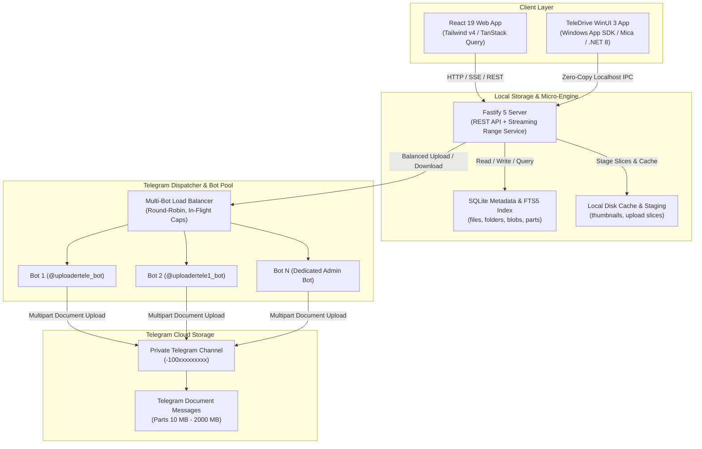
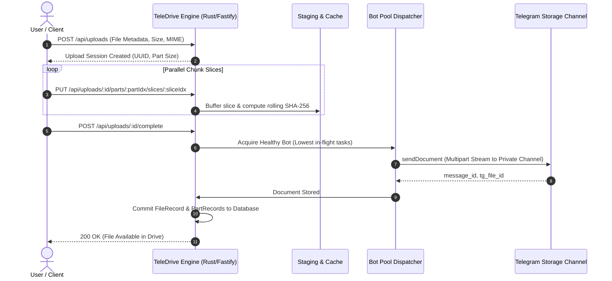
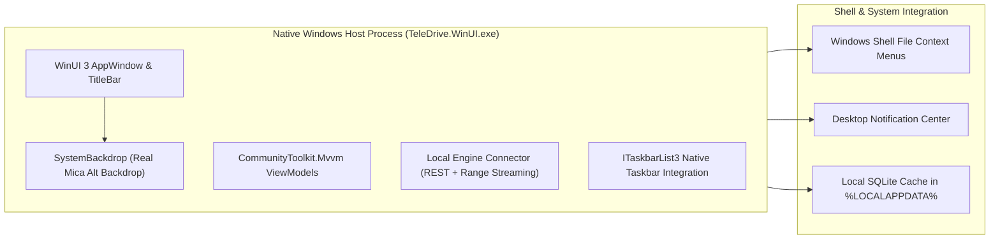
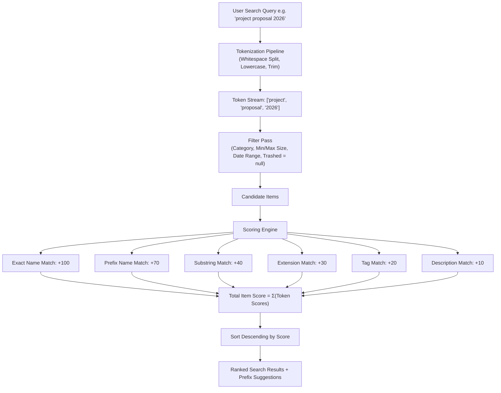
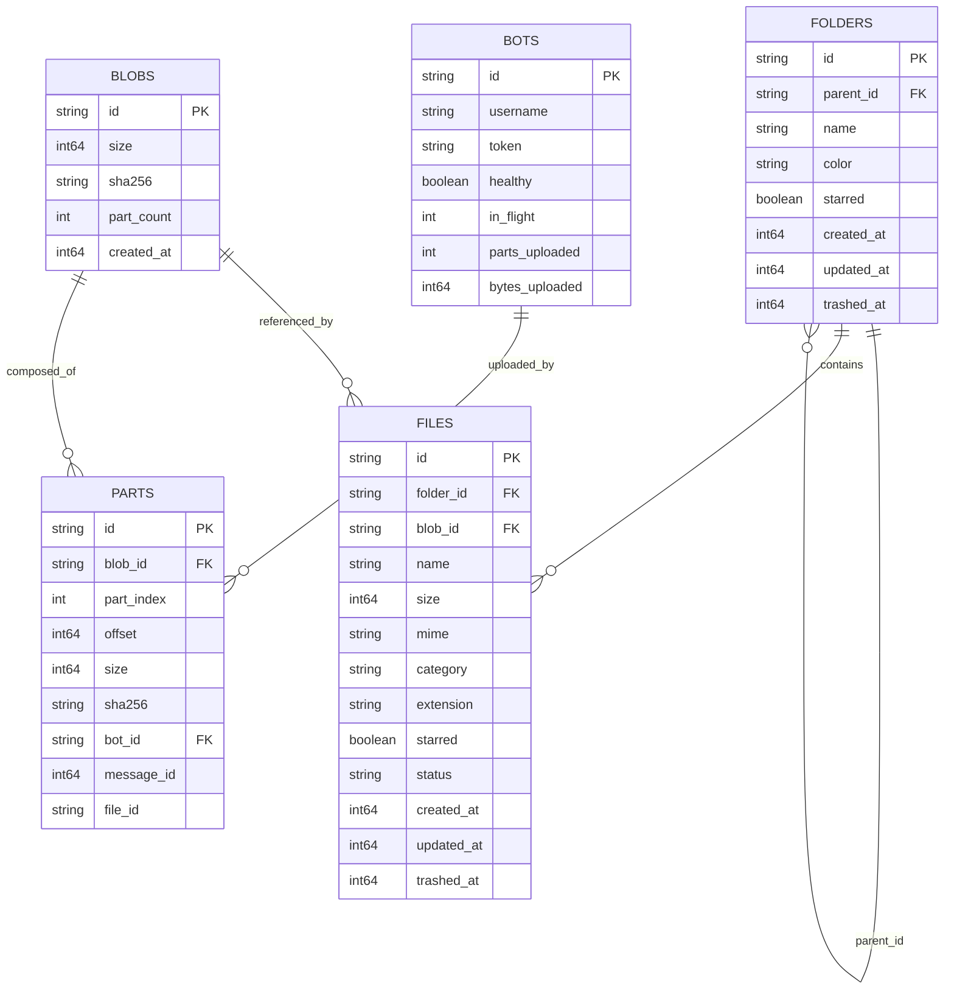

# TeleDrive 🚀
### A self-contained desktop drive — your private Telegram channel is the storage engine

[](winui-desktop/)
[](server/)
[](web/)
[](winui-desktop/)
[](server/src/db.ts)

**TeleDrive** is an unlimited-capacity cloud & desktop drive backed by a private Telegram channel. Document bytes live in Telegram; the PC keeps only the metadata index, thumbnails, and short-lived upload staging files.

Files of arbitrary size are cryptographically verified, split into parts, and streamed with low-latency HTTP Range support (enabling pausing/resuming transfers and instant random-access seeking for 4K video playback).

TeleDrive is delivered across high-performance form factors:
1. **`TeleDrive WinUI` (Native Windows 11 App)**: Built with WinUI 3, Windows App SDK, and .NET 8. Features Windows 11 Fluent Design with real Mica backdrop, custom borderless titlebar, multi-tier card sizing, persistent `%LOCALAPPDATA%` layout configuration, native taskbar progress (`ITaskbarList3`), right-click shell context menus, and instant cloud chunk streaming.
2. **`TeleDrive Server` & Web SPA**: Production Node 22 LTS / Fastify 5 + SQLite FTS5 backend paired with a React 19 / Tailwind v4 Google-Drive-class web application.

---

## Table of Contents
1. [System Architecture](#1-system-architecture)
2. [Telegram Storage & Chunking Protocol](#2-telegram-storage--chunking-protocol)
3. [Native WinUI 3 Desktop Application](#3-native-winui-3-desktop-application)
4. [Search Indexing & Autocomplete Engine](#4-search-indexing--autocomplete-engine)
5. [Explorer & File Manager Capabilities](#5-explorer--file-manager-capabilities)
6. [Database Schema & ERD](#6-database-schema--erd)
7. [REST API Reference](#7-rest-api-reference)
8. [Keyboard Shortcuts Matrix](#8-keyboard-shortcuts-matrix)
9. [Build, Packaging & Deployment](#9-build-packaging--deployment)
10. [Troubleshooting & Verification](#10-troubleshooting--verification)

---

## 1. System Architecture

TeleDrive is built with a decoupled storage abstraction where files, metadata, and physical chunk transport are separated cleanly.



### Key Architectural Pillars
- **Telegram-Only Document Storage**: Every new upload is sent to your private Telegram storage channel through the bundled local Bot API. The local `vault` folder is legacy read-only; no new document bytes are written there.
- **Lightweight Local Footprint**: The PC stores only the metadata index (`teledrive.json`), thumbnails, streaming cache, and temporary upload slices. Staging files are deleted as soon as their part is stored in Telegram.
- **Real Disk Awareness**: The app reports real free/total bytes for the metadata/staging volume, shows them in the sidebar and Storage settings, and rejects a new upload with HTTP 507 before staging can fill the disk.
- **Self-Maintaining Storage**: Trash older than 30 days is purged automatically, abandoned staging files are swept, and orphaned Telegram-part records are recovered on startup and cleaned up daily.
- **Drive Health Check**: Settings → System can verify the local metadata index and report missing staging parts or orphaned Telegram uploads without re-reading gigabytes of content.
- **Zero Raw File Limits**: Files of any size (100 MB to 1 TB+) are split into parts (default 512 MB, adjustable up to 2 GB), then streamed into parallel HTTP slices.
- **Restart-Safe Resumability**: Upload sessions persist to `uploads/<id>/session.json`, and paused downloads resume with `Range: bytes=<offset>-`. Large downloads stream directly into a user-chosen file through the File System Access API, so multi-gigabyte files never have to fit in browser memory.
- **Automatic Recovery**: If an older build lost a file record, startup imports records from the legacy WinUI database and backup state, then matches orphaned Telegram parts to their original document names. Completed uploads reappear in the drive without re-uploading.
- **Content-Addressable Deduplication**: Files with identical content share the same underlying `blob_id`. Copying or moving files is an instant $O(1)$ operation that consumes zero additional storage.

---

## 2. Storage Engines & Chunking Protocol

Every uploaded file undergoes automated slicing, hashing, and multi-bot dispatch:



### 1. Resumable Chunking Pipeline
- Files are logically divided into parts ($P_0, P_1, \dots, P_n$); the part size is adjustable from 5 MB up to 2000 MB with the bundled local Bot API (45 MB when using the public Telegram Bot API), and the choice is saved across restarts.
- Parts are transferred as smaller HTTP slices (32 MB by default, configurable). If a network interruption occurs, the client fetches the fresh slice map and resumes exactly from the last durable slice.
- SHA-256 checksums are calculated per part and stored with the Telegram message reference; completed uploads are validated before the file is marked ready.

### 2. Multi-Bot Load Balancing
- Bot pool tracks `in_flight` requests, cumulative bytes transferred, and health states.
- If a bot receives a 429 (`Too Many Requests`) from Telegram Bot API, the dispatcher automatically quarantines the bot for the `retry_after` duration and fails over the pending part to an active peer bot.

### 3. Transparent Range Streaming
- File playback (`/api/files/:id/content` or `/api/download/:id`) parses the standard HTTP `Range: bytes=start-end` header.
- The engine maps the requested byte range to the exact part index and offset, streaming only the necessary byte slice. This allows instantaneous random seeking in multi-gigabyte video files.

---

## 3. Native WinUI 3 Desktop Application

The native desktop experience for TeleDrive is implemented in **WinUI 3** and **Windows App SDK 1.6 / .NET 8**, adhering to Windows 11 Fluent Design principles.



### Key WinUI 3 Features
1. **Windows 11 Fluent Design**: Mica Alt dynamic material backdrop that blends into the desktop wallpaper and system theme.
2. **Integrated Window Drag & Controls**: Borderless custom title bar with native Windows 11 snap layouts support.
3. **Taskbar State & Transfer Progress**: Uses `ITaskbarList3` COM interop to display accurate green/yellow/red transfer progress indicators on the Windows taskbar icon.
4. **Instant Cloud Streaming**: Directly streams large files with range-based chunking from the Telegram storage engine.

---

## 4. Search Indexing & Autocomplete Engine

TeleDrive includes a high-speed search and indexing engine that executes multi-token ranked matches across file and folder metadata.



### Search Scoring Rules
- **Exact Name Match**: `+100` points.
- **Prefix Name Match**: `+70` points.
- **Substring Match**: `+40` points.
- **File Extension Exact Match**: `+30` points.
- **Tag Match**: `+20` points.
- **Description Match**: `+10` points.

### Autocomplete API (`/api/search/suggest`)
The suggestion engine computes prefix matches against the live in-memory registry, returning instant keyword suggestions with sub-millisecond response times.

---

## 5. Explorer & File Manager Capabilities

TeleDrive delivers a feature-complete file management experience that mirrors native desktop file explorers:

### 1. Advanced Clipboard System
- **Cut (`Ctrl+X`)**: Stages items for relocation. Cut items display a standard **`opacity-40` dashed border** state across both Grid and List views.
- **Copy (`Ctrl+C`)**: Stages items for duplication.
- **Paste (`Ctrl+V`)**: Executes the move or copy operation. Pasting copied files reuses content-addressable blobs with zero re-upload delay.
- **Staged Action Dock**: A floating dock displays staged clipboard counts with a one-click "Paste here" trigger.

### 2. Folder Color Accents
- Right-click any folder -> **Change color** palette.
- Choose between Amber, Sky Blue, Emerald Green, Rose Pink, Violet Purple, and Slate Gray.
- Colors persist to the database (`color: string`) and dynamically style folder icons and badges.

### 3. Breadcrumb Trail & Parent Navigation
- Dynamic breadcrumb path with immediate navigation to any parent level.
- **Up to Parent (`CornerLeftUp` / `Alt+Up` / `Backspace`)**: Ascends one level up the folder hierarchy.
- **Copy Path Button**: Copies the hierarchical path (e.g. `My Drive / Documents / Projects`) to the clipboard with confirmation toast.

### 4. Card Size Presets
Users can toggle between 5 folder/file grid sizes in Settings or via View Options:
- **Tiny (175px)**: High-density overview for large datasets.
- **Compact (200px)**: Compact view with legible filenames.
- **Standard (235px - Default)**: Balanced card proportions with media thumbnails.
- **Large (280px)**: Large preview tiles.
- **Extra Large (340px)**: Maximum thumbnail fidelity for photography and video workflows.

---

## 6. Database Schema & ERD



---

## 7. REST API Reference

| Method | Endpoint | Description |
|---|---|---|
| `GET` | `/api/drive?folderId=:id` | Fetch contents of a folder, breadcrumb trail, and metadata |
| `GET` | `/api/folders/tree` | Retrieve recursive folder tree hierarchy |
| `POST` | `/api/folders` | Create a new directory (`{ name, parentId }`) |
| `PATCH` | `/api/folders/:id` | Update folder name or accent color (`{ name, color }`) |
| `POST` | `/api/items/move` | Move items to a folder (`{ fileIds, folderIds, targetFolderId }`) |
| `POST` | `/api/items/copy` | Recursively copy files/folder trees (`{ fileIds, folderIds, targetFolderId }`) |
| `POST` | `/api/files/:id/copy` | Duplicate a file in place (shares the original blob) |
| `POST` | `/api/files/text` | Create a text file (`{ name, content, folderId }`) |
| `PUT` | `/api/files/:id/text` | Replace a text file's contents (plain-text body) |
| `POST` | `/api/zip` | Build a downloadable ZIP for selected files/folders (`{ fileIds, folderIds }`) |
| `GET` | `/api/zip/:id` | Download a generated ZIP archive |
| `POST` | `/api/items/trash` | Move items to Trash (`{ fileIds, folderIds }`) |
| `POST` | `/api/items/star` | Star or unstar items (`{ fileIds, folderIds, starred }`) |
| `POST` | `/api/uploads` | Initiate a resumable upload session |
| `PUT` | `/api/uploads/:id/parts/:partIdx/slices/:sliceIdx` | Upload an HTTP binary slice |
| `POST` | `/api/uploads/:id/complete` | Finalize upload session and commit to Telegram |
| `GET` | `/api/files/:id/content` | Stream file content with HTTP 206 Range support |
| `GET` | `/api/download/:id` | Direct file download trigger with attachment disposition |
| `GET` | `/api/search?q=:query` | Multi-token ranked search with faceted filters |
| `GET` | `/api/search/suggest?q=:query` | Live autocomplete suggestions |
| `GET` | `/api/stats` | Storage utilization, category counts, and trash metrics |
| `GET` | `/api/system` | Runtime, disk, vault, queue, bot, and transfer diagnostics |
| `POST` | `/api/system/retry-failed` | Reset failed upload parts so clients can resume them |
| `POST` | `/api/system/verify-vault` | Check local vault parts for missing files/size mismatches |
| `POST` | `/api/system/open-vault` | Open the local vault folder in the desktop file manager |

---

## 8. Keyboard Shortcuts Matrix

| Shortcut | Context | Action |
|---|---|---|
| `Space` | Explorer Item Selected | Toggle Instant File QuickLook / Media Preview |
| `Enter` | Explorer Item Selected | Open Folder or Launch Preview Modal |
| `F2` | Single Item Selected | Trigger Inline Rename Dialog |
| `Delete` | One or More Items Selected | Move Selected Item(s) to Trash |
| `Ctrl + A` | Explorer | Select All Files and Folders |
| `Ctrl + C` | Explorer Selection | Copy Selected Items to Clipboard |
| `Ctrl + X` | Explorer Selection | Cut Selected Items to Clipboard (dimmed opacity) |
| `Ctrl + V` | Explorer Active | Paste Clipboard Items into Current Directory |
| `Ctrl + D` | Explorer Selection | Download Selected Item(s) / Batch Zip |
| `Arrow Keys` | Explorer | Navigate Selection Across Grid / List Items |
| `Backspace` / `Alt + ↑` | Explorer (No Input Active) | Navigate Up to Parent Folder |
| `Esc` | Anywhere | Clear Active Selection or Dismiss Context Menus |
| `Ctrl + K` / `/` | Navbar | Focus Search Bar |
| `i` | Explorer | Toggle File / Folder Inspection Details Drawer |

---

## 9. Build, Packaging & Deployment

### Prerequisites
- Node.js ≥20.19 (Node 22 LTS recommended)
- .NET 8 SDK (with Windows App SDK)
- WiX Toolset v3 / v4 (for MSI installer generation)

### 1. Development Mode (Mock Bot API)
To run the full stack locally without real Telegram credentials:
```bash
npm run dev:mock
```
- Mock Bot API server binds to `http://localhost:8082`
- Fastify server binds to `http://localhost:8080`
- Vite Web UI binds to `http://localhost:5173`
- Default login: `admin` / `admin12345`

### 2. Full Production Build
```bash
npm run build
```
Compiles web assets into `web/dist` and TypeScript server into `server/dist`.

### 3. Build & Package Native Windows MSI (`TeleDrive-Setup.msi`)
```bash
npm run build:winui
node scripts/build-winui-msi.js
```
This automated pipeline:
1. Builds the production WinUI 3 desktop application (`TeleDrive.WinUI.exe`).
2. Stages the release payload and assets.
3. Executes WiX `candle` and `light` to produce `TeleDrive-Setup.msi`.
4. Copies the output installer to your Desktop (`C:\Users\Kailasnath T\Desktop\TeleDrive-Setup.msi`), Downloads, and repo root.

---

## 10. Troubleshooting & Verification

- **Verify Type Safety & Linting**:
  ```bash
  npm run typecheck && npm run lint
  ```
- **Run Server Tests**:
  ```bash
  npm test
  ```
- **Doctor Diagnostics CLI**:
  ```bash
  npm run doctor
  ```
  Validates Telegram bot tokens, channel administrator permissions, disk thresholds, and external media tools.
- **Channel ID Discovery**:
  ```bash
  npm run channel:find
  ```
  Posts a test probe to discover the Telegram `-100…` channel identifier.

---

## License
TeleDrive is released under the **MIT License**. Engineered for privacy, security, and unlimited personal cloud storage.
